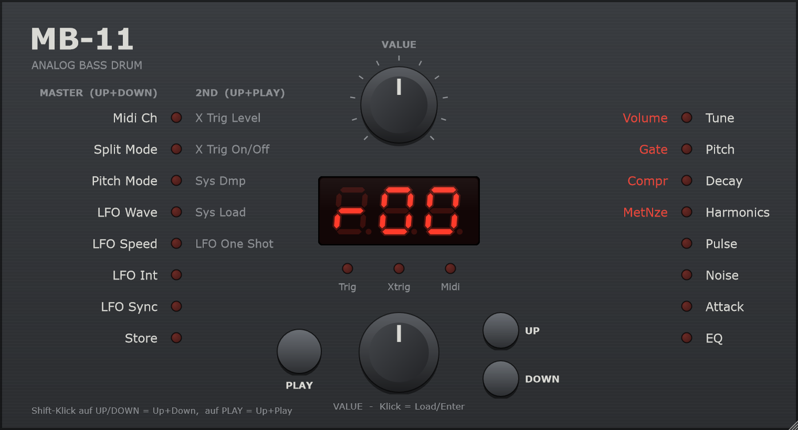

# MB-11 – Schnellstart

MB-11 ist eine analog klingende Bassdrum. Bedient wird sie wie ein kleines Hardware-Gerät: ein Display, ein paar Taster, zwei VALUE-Regler.

Ausführlich: [Handbuch](Handbuch.md).



---

## Die Bedienelemente

| Element | Funktion |
|---|---|
| **Display** | Zeigt Preset oder Wert des gewählten Parameters |
| **VALUE-Encoder** (unten) | Wert ändern (ziehen oder scrollen). **Klick** = Load/Enter |
| **VALUE-Poti** (oben) | Schnell über große Bereiche. Muss den Wert erst „abholen“, dann wird der Zeiger rot |
| **UP / DOWN** | Durch die Parameter blättern |
| **PLAY** | Sound auslösen |
| **LEDs rechts** | Welcher Klangparameter gewählt ist |
| **LEDs links** | Welcher Master-/2nd-Parameter gewählt ist |
| **Trig / Xtrig / Midi** | Blinken bei Auslösung bzw. MIDI-Empfang |
| **MB-11-Logo** | Klick zeigt Version und Build |

**Feinjustage:** **Shift** gedrückt halten beim Ziehen oder Scrollen – der Encoder reagiert dann 3×, das Poti 4× feiner.

Weil man mit der Maus nicht zwei Taster gleichzeitig drücken kann, gilt **Shift-Klick** als „zweiter Taster“:

| Zwei Taster zugleich | Bei MB-11 | Öffnet |
|---|---|---|
| UP + DOWN | **Shift-Klick auf UP oder DOWN** | Master-Ebene |
| UP + PLAY | **Shift-Klick auf PLAY** | 2nd Function |

---

## Die drei Ebenen

### 1. Preset-Modus – keine LED leuchtet
Nach dem Start bist du hier. Das Display zeigt `Pr0`–`Pr9` (eigene Presets) oder `r00`–`r99` (Werkssounds).
**Encoder drehen** = Preset wechseln.

### 2. Klangparameter – LED rechts
- **LED leuchtet** → der Parameter **rechts** daneben ist aktiv (Tune … EQ)
- **LED blinkt** → der **rote** Parameter **links** daneben ist aktiv (Volume, Gate, Compr, MetNze)

```
Preset ──DOWN──► Tune ► Pitch ► Decay ► Harmonics ► Pulse ► Noise ► Attack ► EQ
                                                                              │
Preset ◄──DOWN── MetNze ◄ Compr ◄ Gate ◄ Volume ◄────────────────────────────┘
                 (rot, LED blinkt)
```

**UP** läuft dieselbe Runde rückwärts. Vom Preset-Modus aus bist du mit **2× UP** bei Compr, mit **1× UP** bei MetNze.

**Zurück in den Preset-Modus:** UP über *Tune* hinaus oder DOWN über *MetNze* hinaus.

### 3. Master & 2nd Function – LED links
- **Master** (Shift-Klick UP/DOWN): LED leuchtet, Parameter links (Midi Ch … Store)
- **2nd Function** (Shift-Klick PLAY): LED blinkt, Parameter daneben (X Trig Level … LFO One Shot)

Mit UP/DOWN blätterst du, mit dem Encoder änderst du den Wert. **Zurück:** derselbe Shift-Klick noch einmal oder **10 Sekunden nichts tun**.

---

## Häufige Aufgaben

**Sound auswählen**
Im Preset-Modus den Encoder drehen und PLAY drücken.

**Sound anpassen**
DOWN bis zum gewünschten Parameter, dann den Encoder drehen. Ein **Punkt rechts unten im Display** zeigt: Das Preset ist verändert (Edit-On).

**Änderungen verwerfen**
**Encoder klicken** – das Preset wird neu geladen.

**Sound speichern**
1. Shift-Klick UP → Master-Ebene
2. DOWN bis **Store** (letzte LED links), das Display zeigt `Sto`
3. Encoder klicken → das Display blinkt
4. Speicherplatz mit dem Encoder wählen (`Pr0`–`Pr9` empfohlen)
5. Encoder klicken → gespeichert

**Melodisch spielen (Bass-Synth)**
Master-Ebene → **Split Mode** auf `SM2`, **Pitch Mode** auf `SEM`. Jetzt spielen die Noten C1–F3 in Halbtönen. Tipp: Tune niedrig, Decay lang.

**LFO nutzen**
Master-Ebene → **LFO Int** hochdrehen (0 = aus), dazu **LFO Wave** und **LFO Speed** einstellen.
`Mid` als Speed läuft synchron zum Tempo des Hosts. **LFO Sync** `SYn` startet den LFO bei jedem Schlag neu.

**Per Audio auslösen (X Trig)**
Im DAW ein Signal auf den Sidechain-Eingang „X Trig In“ legen. Dann 2nd Function → **X Trig On/Off** auf `_on` und **X Trig Level** so weit erhöhen, bis es sauber auslöst. (Nicht in der CLAP-Version.)

**Preset als Datei sichern / laden**
2nd Function → **Sys Dmp** (Encoder-Klick speichert eine `.syx`-Datei) bzw. **Sys Load** (Encoder-Klick lädt eine Datei ins aktuelle Preset).

---

## Wo liegen die Presets?

Alle 110 Speicherplätze (`Pr0`–`Pr9`, `r00`–`r99`) stehen in **einer Datei**, die sich alle MB-11-Instanzen und Formate (AU, VST3, CLAP, Standalone) teilen – wie der Speicher im Gerät:

| System | Datei |
|---|---|
| macOS | `~/Library/Application Support/MB-11/PresetBank.xml` |
| Windows | `%APPDATA%\MB-11\PresetBank.xml` |
| Linux | `~/.config/MB-11/PresetBank.xml` |

- Die Datei entsteht beim ersten **Store**. Vorher gelten die Werkssounds.
- **Sichern:** Datei kopieren. **Werkszustand:** Datei löschen.
- Du musst nichts selbst dort ablegen – MB-11 speichert automatisch.
- Unabhängig davon speichert dein DAW-Projekt den aktuellen Sound mit, auch ungespeicherte Änderungen.
- `.syx`-Dateien aus **Sys Dmp** landen dort, wo du sie im Dialog hinlegst (Vorschlag: Dokumente).

---

## Die Klangparameter

| Parameter | Bewirkt | Achtung |
|---|---|---|
| **Tune** | Stärke des Pitch-Sweeps („Punch“) | Nicht die Tonhöhe! |
| **Pitch** | Grundtonhöhe (10 Hz … hoch) | |
| **Decay** | Länge der Kick | |
| **Harmonics** | Sinus → härter, paukenartig | |
| **Pulse** | Klick-Anteil im Attack | Nur hörbar mit Attack > 0 |
| **Noise** | Rausch-Anteil im Attack | Nur hörbar mit Attack > 0 und niedrigem EQ |
| **Attack** | Lautstärke von Pulse + Noise | 0 = kein Attack |
| **EQ** | Filter: macht dumpfer | 0 = offen, höher = dumpfer |
| **Volume** | Gesamtlautstärke | Am besten auf 255 lassen |
| **Gate** | Länge des Auslöseimpulses: kurz = Klick, lang = Klatschen | |
| **Compr** | Kürzt den Ausklang | Höher = kürzer, kein Kompressor |
| **MetNze** | 0 = Rauschen, sonst metallische Muster | Jeder Wert klingt anders – ausprobieren! |

---

## Tastatur (nur Standalone)

| Taste | Funktion |
|---|---|
| Space | PLAY |
| ↑ / ↓ | UP / DOWN |
| ← / → | Encoder −1 / +1 (Shift: ±10) |
| Return | Encoder-Klick |
| Shift + ↑/↓ | Master-Ebene |
| Shift + Space | 2nd Function |

---

## MIDI

- **Note C1 (36)** löst die Bassdrum aus, im Split Mode `SM2` die Noten C1–F3.
- Der **MIDI-Kanal** wird in der Master-Ebene eingestellt (Standard: 1).
- **Program Change** wählt das Preset.
- Alle Klangparameter sind per **MIDI-CC** steuerbar und im DAW automatisierbar:

| CC | Parameter | CC | Parameter |
|---|---|---|---|
| 100 | Tune | 113 | Compr |
| 101 | Pitch | 114 | Gate |
| 102 | Decay | 115 | MetNze |
| 103 | Harmonics | 117 | Volume |
| 104 | Pulse | 120 | LFO Sync |
| 105 | Noise | 121 | LFO Int |
| 106 | Attack | 122 | LFO Speed |
| 107 | EQ | 123 | LFO One Shot |
